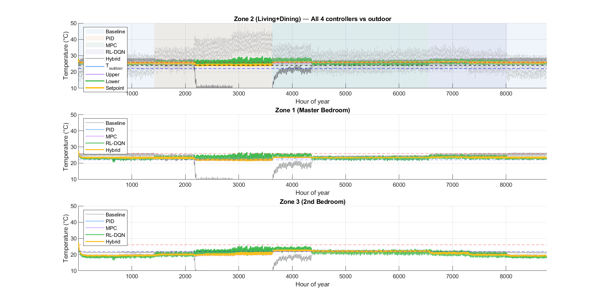
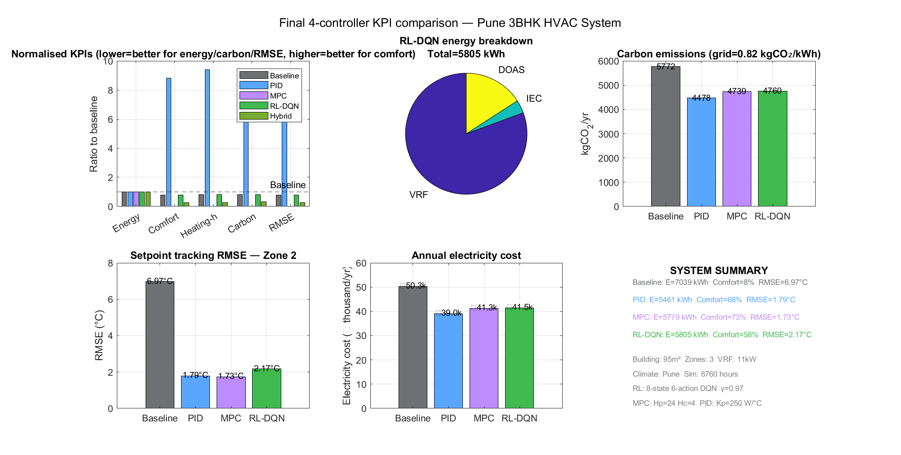

# Comparative Evaluation of HVAC Control Strategies for Residential Buildings in Pune, India

A MATLAB/Simulink project for studying residential HVAC control in a three-zone Pune 3BHK building. The project models building thermal response, VRF cooling, indirect evaporative cooling, outdoor-air ventilation, and indoor air quality, with controller logic for rule-based, PID, MPC, and DQN approaches.

> **Implementation note:** The paper in [`PUNE_HVAC.pdf`](PUNE_HVAC.pdf) reports a five-controller study that includes a Hybrid MPC-PID controller. The code and saved model currently included in this repository select four controllers: Baseline, PID, MPC, and RL-DQN. The manuscript's Hybrid results therefore should not be treated as reproduced by the checked-in implementation. The paper metrics below are reported as published in that manuscript, not independently rerun or validated here.

## Study at a glance

- **Case study:** 95 m2, three-zone residence in Pune, India
- **Weather horizon:** 8760 hourly steps (one year) in the manuscript and default builder settings
- **Plant:** three-zone lumped thermal model, variable-refrigerant-flow (VRF) cooling, indirect evaporative cooler (IEC), and dedicated outdoor-air system (DOAS)
- **Indoor air quality:** modeled CO2 and PM2.5
- **Controllers in the checked-in model:** Baseline, PID, MPC, RL-DQN
- **Controller additionally described in the paper:** Hybrid MPC-PID-safety fusion

The study evaluates comfort, temperature tracking, energy, electricity cost, carbon, and indoor air quality. It is a simulation study for one modeled dwelling and weather profile, not a field validation or a general performance guarantee.

## Results reported in the paper

The following values are transcribed from the manuscript tables. They are **paper-reported results**; the repository's current four-controller implementation does not include the paper's Hybrid controller, and these results have not been reproduced from this checkout.

| Controller | Zone 2 RMSE (deg C) | Comfortable hours (%) | Annual electricity (kWh) | Energy change vs. baseline |
|---|---:|---:|---:|---:|
| Baseline | 6.84 | 11.3 | 7,110.8 | -- |
| PID | 1.79 | 68.2 | 5,460.9 | -23.2% |
| MPC | 1.73 | 72.8 | 5,779.5 | -18.7% |
| RL-DQN | 2.17 | 57.8 | 5,805.0 | -18.4% |
| Hybrid MPC-PID | 1.73 | 68.1 | 5,558.8 | -21.8% |

The manuscript also reports that indoor CO2 and PM2.5 were identical across controllers because those outcomes were driven by fixed ventilation, infiltration, and filtration assumptions. It reports persistently high PM2.5 in the modeled recirculation-only filtration arrangement. These findings describe the assumptions in this simulation and should not be interpreted as measurements of an actual home.

## Repository contents

```text
.
├── README.md
├── PUNE_HVAC.pdf                         # Study manuscript
├── Comparative Evaluation ... .pptx      # Presentation
├── IND_Pune.430630_ISHRAE.epw             # Pune EPW weather data
├── sim800hrs.m                            # Alternate builder/simulation script
├── docs/
│   └── FILE_GUIDE.md                      # File roles and model notes
├── figures/                               # Existing plots
├── hvac components code/                  # Standalone controller, equipment, IAQ functions
└── main model/
    ├── Pune_HVAC_Full_Simulink500hrs.m   # Main builder and MATLAB-side comparison
    ├── Pune_HVAC_Complete.slx             # Saved four-controller Simulink model
    ├── SimWS_Full.mat                     # Time-series/model workspace data
    ├── postsimulation.m                   # Separate Simulink simulation/post-processing path
    └── *.mat                               # Results, workspace, and RL weight artifacts
```

See [`docs/FILE_GUIDE.md`](docs/FILE_GUIDE.md) for the role of each tracked file. The EPW file is included as weather data, but the main builder's default demo-data path generates synthetic inputs; the presence of the EPW file alone does not mean it is used in that path.

### Selected figures





## Requirements

- MATLAB R2021a or later, as stated in the source header
- Simulink
- MATLAB Function block support; a compatible Stateflow installation/license may be required depending on MATLAB release and model configuration

The exact MATLAB release, licensed products, and toolbox requirements have not been independently verified in a clean environment. No third-party MATLAB package installation is documented in this repository.

## Run the main builder

The main script is located under `main model`. Open MATLAB, set the current folder to that directory, then run:

```matlab
Pune_HVAC_Full_Simulink500hrs
```

The active settings in the script use synthetic demo inputs, set `SIM_DAYS = 365`, build the model, and generate plots and MAT results. The filename contains `500hrs`, but the checked-in default is 365 days (8760 hourly steps), not 500 hours.

### Important side effects

The builder begins with `clearvars; clc; close all`. It creates or overwrites `SimWS_Full.mat`, `RL_Network_Weights.mat`, `All_Results.mat`, and figure files in the current folder. The model-building function closes an already loaded `Pune_HVAC_Complete` model without saving and deletes an existing `Pune_HVAC_Complete.slx` before rebuilding it. Run it only in a disposable copy if you need to preserve the checked-in files or your MATLAB session.

Although the script prints `RUN_SIMULATION = true`, its active workflow performs MATLAB-side controller calculations and builds the Simulink model; it does not call `sim` in that path. Model simulation is a separate step.

## Open and simulate the saved model

Keep [`Pune_HVAC_Complete.slx`](main%20model/Pune_HVAC_Complete.slx) and [`SimWS_Full.mat`](main%20model/SimWS_Full.mat) together. The saved model references its workspace data by name. The model has not been validated in a clean MATLAB session from this repository state.

[`postsimulation.m`](main%20model/postsimulation.m) is a separate script that updates the controller selection and calls `sim` for each of the four implemented controllers. It clears the MATLAB workspace, closes figures, runs simulations, and writes `Simulink_Results.mat`; use a disposable copy and review the script before running it.

## Model and workflow scope

- **Main builder:** `main model/Pune_HVAC_Full_Simulink500hrs.m` creates synthetic demo inputs by default, calculates four controller result sets in MATLAB, builds `Pune_HVAC_Complete.slx`, and writes plots and MAT artifacts.
- **Saved Simulink model:** `main model/Pune_HVAC_Complete.slx`, paired with `main model/SimWS_Full.mat` for its model workspace data.
- **Post-simulation path:** `main model/postsimulation.m` runs the saved model for the four controller choices and saves simulation results.
- **Alternate script:** `sim800hrs.m` is a separate builder/simulation implementation. It may target overlapping model/output names; it is not the recommended first entry point.
- **Standalone component functions:** `hvac components code/` contains separate controller, equipment, and IAQ implementations. The saved model contains MATLAB Function block logic; these standalone files should not automatically be assumed to be runtime dependencies of the saved model.

The current repository does not include a Hybrid controller implementation matching the manuscript description. It also does not include the five processed MAT inputs listed in the builder's non-demo-data branch (`Pune_TMY_processed.mat`, `Building_Pune_Params.mat`, `Thermal_Model_Params.mat`, `HVAC_Equipment_Params.mat`, and `IAQ_Model_Params.mat`). The default synthetic-data path does not require those files.

## Reproducibility and interpretation notes

- Baseline and RL-DQN use a fixed 24 deg C target in the manuscript, while PID, MPC, and Hybrid use a night setback. This asymmetry is a comparison limitation acknowledged by the paper.
- The manuscript describes a pretrained, greedy RL-DQN policy and a simplified predictive model; results depend on the supplied weights, model assumptions, schedules, and weather profile.
- The paper notes that its MPC tariff-weighting term does not affect the final demand calculation. It also reports no meaningful aggregate load shift for the tested configurations.
- The paper's IAQ results depend on its fixed infiltration, DOAS, and recirculation/HEPA assumptions; they are not an assessment of a real ventilation installation.
- Existing MAT files and figures are tracked results/artifacts. Their presence does not establish that the full workflow has been rerun from source.

## Citation

The manuscript PDF and presentation are included in this repository. The manuscript's title is *Comparative Evaluation of Rule-Based, PID, Model-Predictive, Reinforcement-Learning, and Hybrid Control Strategies for Residential HVAC Systems in a Composite Climate: A Year-Long Simulink-Based Simulation Study of a 3BHK Residence in Pune, India*. The included manuscript still contains placeholder author and publication details; add the final bibliographic information before citing it formally.

## License

No `LICENSE` file is currently included. Unless a license is added, reuse and redistribution permissions are not specified.
